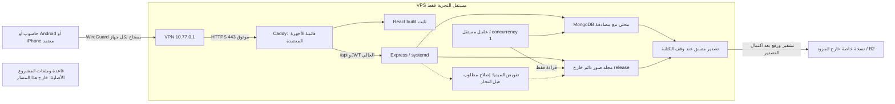

# JOMLA.MA — مخطط استضافة تجربة مغربية مغلقة وآمنة

**التاريخ: 20 أكتوبر 2026 — الحالة: مخطط وملفات مراجعة محلية؛ لا نشر ولا شراء ولا اعتماد إنتاج.**

الأساس هو [تقرير جاهزية 19 أكتوبر](pilot-readiness-2026-10-19.md). هذه المرحلة تجهز طريق التشغيل؛ لا تحوّل نجاح 153 اختبار خلفية و37 اختبار واجهة سابقاً إلى إثبات استضافة أو أجهزة حقيقية. لم نصل إلى قاعدة المشروع الأصلية، ولم نقرأ ملف أسرارها، ولم نغير بياناتها أو ننسخ منتجاتها أو ننشرها. لم نشتر خدمة أو نسجل نطاقاً أو نطبق جداراً نارياً أو شهادة أو وحدة خدمة على جهاز المستخدم.

**قرار المالك المعتمد: عزل صور المسودات لكل مورد.** التنفيذ الحالي لا يحقق ذلك عبر رابط الصورة؛ لذلك يبقى بدء التجربة البشرية متوقفاً حتى إصلاح تفويض الميديا واختباره. ملفات الاستضافة تحجب الصور مؤقتاً ولا يُدّعى أنها تعالج هذا العيب وحدها.

التوصية المعمارية هي VPS واحد مستقل بذاكرة 8GB وقرص دائم، يحتفظ بـReact/Express/MongoDB والعامل الحالي، أمامه Caddy وWireGuard، وخلفه نسخة مشفرة خارج المزود. خيار Hetzner CX33 هو الأقل سعراً من الخيارين المتحققين، **بشرط تأكيد المخزون والسعر عند قرار المالك**؛ التوافر غير مثبت. البديل DigitalOcean مبين بالتكلفة والموارد. لا حاجة الآن إلى Kubernetes أو تقسيم التطبيق أو نقل قاعدة البيانات أو استبدال طابوره.

## 1. ما تحتاجه البنية الحالية فعلياً

فُحصت ملفات التشغيل وملفات القفل والخادم والتخزين والطابور وأدوات النسخ، لا أسماء التقنيات في الوثيقة التأسيسية فقط.

| المكوّن | الواقع في المشروع | متطلب تشغيل التجربة |
|---|---|---|
| الواجهة | React 19.2.5 وCRA/react-scripts 5.0.1؛ ملفات ثابتة بعد build؛ عنوان API الافتراضي `/api` | يبنيها CI أو جهاز بناء موثوق، ويقدم Caddy مجلد build فقط. لا تشغيل `npm start` التطويري للعامة |
| API | Express 5.2.1، وعملية Node مستمرة تبدأ بعد اتصال Mongo | وحدة systemd بحساب غير root، وإيقاف SIGTERM وإعادة تشغيل محدودة؛ لا افتراض طلبات serverless قصيرة |
| البيانات | Mongoose 9.11.2 وMongoDB driver 7.7.0 وفق القفل؛ لا PostgreSQL | Mongo مستقل للتجربة، باسم صريح `jomla_pilot` وحساب خدمة مقيد. وضع standalone يكفي للوظائف الحالية؛ لا يوفر توافراً عالياً أو معاملات متعددة المستندات |
| العامل | طابور Mongo دائم؛ embedded افتراضياً، وexternal موجود ومدعوم | نختار API مع `JOB_WORKER_MODE=external` وعامل systemd منفصل على **الخادم نفسه**، مع `JOB_CONCURRENCY=1` مبدئياً؛ لا عامل مدمج إضافي |
| الصور | ملفات filesystem؛ مسار `UPLOADS_DIR` مطلق، وSharp 0.35.5، وحد رفع 10 MiB و25 مليون بكسل | مجلد حقيقي دائم خارج إصدار الشيفرة؛ يكتب فيه API ويقرأ العامل الملفات نفسها. لا Cloudinary فعال، ولا يلزم S3 لخدمة الصور في هذه الجولة |
| البحث | بحث نصي وبصري محلي من اللون والتوزيع المكاني والحواف؛ الفهرسة بواسطة العامل | CPU وذاكرة ومراقبة؛ لا يحتاج هذا البحث إلى مفتاح AI. سقف 5000 مرشح ليس إثبات تحمل تجاري |
| Redis | اختياري للتخزين المؤقت، وليس طابور الوظائف | `DISABLE_REDIS=1` يقلل المكونات دون تعطيل الطابور |
| الصحة | live للعملية، وready لاتصال Mongo وping | نضيف في **خطة التشغيل** اختبار صورة ومهمة؛ استجابة ready برمز 200 لا تثبت سلامة العامل أو ديمومة القرص |
| الاختياري | AI وBrave وتخزين سحابي ليست خدمات ناجحة مثبتة في التجربة السابقة | مفاتيح فارغة، وخروج API/worker محدود محلياً؛ لا تكاليف أو وعود بها في النطاق الأول |

المراجع المحلية: [start.js](../backend/start.js)، [server.js](../backend/server.js)، [worker.js](../backend/workers/worker.js)، [mediaStorage.js](../backend/services/mediaStorage.js)، [JOBS.md](../docs/JOBS.md)، [BACKUPS.md](../docs/BACKUPS.md).

إصدار Node المحلي الذي قرأناه هو 25.9.0. يبين [جدول Node الرسمي](https://nodejs.org/en/about/previous-releases) أن Node 25 منتهي الدعم وأن Node 24 هو LTS؛ نختار **أحدث تحديث أمني من Node 24 LTS** للاستضافة ثم نعيد التحقق على Linux. الحد الأدنى 20.19 في متطلبات بعض الاعتماديات لا يعني أن Node 20 مناسب اليوم؛ لا نختار إصداراً منتهي الدعم لمجرد قبول حقل engines له. لم نثبت أو نبدل Node المحلي.

مقاس البداية المقترح: x86_64، و4 vCPU مشتركة، و8GB RAM، و80GB قرص أو أكثر. يحدد قالب `NODE_OPTIONS` الجيل القديم من ذاكرة V8 إلى 512 MiB لكل عملية، ويقترح ذاكرة تخزين مؤقت WiredTiger بحجم 1 GiB. لا يمثل ذلك سقفاً لذاكرة العملية كلها؛ تخصيصات Sharp/libvips الأصلية وBuffers وذاكرة Mongo الأخرى تحتاج قياساً مستقلاً. كذلك يحد `JOB_CONCURRENCY=1` العامل فقط، ولا يحد كل طلبات API المتزامنة. هذه إعدادات أولية قابلة للضبط، ولا تثبت السعة. يجب قياس CPU/RSS والبحث والرفع أثناء التدريب. لا تنسخ node_modules الخاص بـWindows إلى Linux؛ استعمل القفل و`npm ci` على نظام البناء المستهدف.

تقرأ وحدتا API والعامل الملف نفسه عبر `EnvironmentFile=/etc/jomla-pilot/runtime.env`، ويبدأ كل منهما Node مباشرةً دون غلاف npm. لا يُنسخ ملف `.env` الأصلي إلى الإصدار. يمنح القالب API حق الكتابة في مجلد الصور الدائم، ويمنح العامل قراءة المجلد نفسه فقط؛ هذه قيود مقترحة في systemd، ولم تُطبق أو تُختبر على مضيف Linux بعد.

## 2. مخطط البنية المقترحة

الخط المنقط عمل مطلوب، وليس مساراً منفذاً. لا توجد وصلة من staging إلى الأصل. غياب التوافر العالي HA مقبول فقط لتجربة صغيرة بإشراف ونافذة صيانة وخطة استعادة؛ تعطل VPS يوقف API والبيانات والعامل معاً.

## 3. خيارا الاستضافة والأسعار المحققة

تحققنا من صفحات المزودين العامة يوم **20 أكتوبر 2026**، دون حساب شراء أو فاتورة أو حجز موارد. الأسعار الأصلية أدناه أسعار قائمة؛ النتائج بالدرهم **حساب ميزانية** وليست عروضاً مؤكدة أو أسعار تسوية بطاقة.

### منهج التحويل والتكلفة

صفحتا [Wise EUR/MAD](https://wise.com/gb/currency-converter/eur-to-mad-rate) و[Wise USD/MAD](https://wise.com/gb/currency-converter/usd-to-mad-rate) المعروضتان عند الفحص أعطتا سعراً وسطياً تقريبياً: 1 EUR ≈ 11.00 MAD و1 USD ≈ 9.814 MAD؛ استعملنا هذين الرقمين المقربين. صفحة بنك المغرب رفضت الجلب برمز 403، لذلك **لا ننسب هذه المعدلات إلى بنك المغرب**. سعر البنك ورسوم البطاقة والضرائب قد تختلف.

نفترض للمقارنة متوسط 50GB عشرياً من النسخ المشفرة المحتفظ بها خارج الخادم؛ هذا **سيناريو حجم غير مقاس** وليس ضماناً للسعة أو حداً للتكلفة. السعر المنشور لخدمة [B2](https://www.backblaze.com/cloud-storage/pricing) هو 6.95 USD لكل TB/30 يوماً، فيعطي السيناريو 0.3475 USD ≈ 3.41 MAD دون طرح أي سماح مجاني. تغير الحجم والاحتفاظ والاستعادة والمرور قد يغير الفاتورة.

| العنصر | A — Hetzner Cloud CX33، ألمانيا/فنلندا | B — DigitalOcean Basic Regular، منطقة أوروبية يختارها المالك |
|---|---|---|
| المعالج والذاكرة |4 vCPU مشتركة، و8GB |4 vCPU مشتركة، و8GiB |
| القرص المرفق |80GB NVMe |160GiB SSD |
| المرور المدرج |20TB في الموقع الأوروبي |5000GiB |
| سعر الخادم المنشور |8.49 EUR/شهر، دون IPv4 وVAT |48 USD/شهر للخطة المدرجة؛ الضرائب عند الفاتورة |
| IPv4 |0.50 EUR إضافية/شهر |العنوان الأساسي ضمن خدمات Droplet؛ لا Reserved IP إضافي في التصميم |
| الحوسبة مع IPv4 بالدرهم |98.89 MAD |471.07 MAD |
| مع سيناريو النسخ الخارجية 50GB |**102.30 MAD/شهر تقريباً** |**474.48 MAD/شهر تقريباً** |
| إضافة نسخ قرص المزود، اختيارية |20% من 8.49 EUR ≈ 18.68 MAD؛ الإجمالي ≈ **120.98 MAD** |خطة daily بنسبة 30% من 48 USD ≈ 141.32 MAD؛ الإجمالي ≈ **615.80 MAD** |
| توافر الموارد |صفحة الويب المقروءة أظهرت not available؛ لم يُفحص مخزون حساب/منطقة. السعر لا يساوي مورداً قابلاً للحجز |لم نفحص مخزون منطقة داخل حساب أو شاشة checkout؛ لا ضمان حجز |
| مسؤولية التشغيل |Linux وMongo والأمان والنسخ على المشغل |المسؤولية نفسها؛ هذه Droplet وليست خدمة Mongo مدارة |

مصادر A: [أسعار Hetzner المعدلة منذ 15 يونيو 2026](https://docs.hetzner.com/general/infrastructure-and-availability/price-adjustment/)، [موارد CX33 وصفحة التوافر](https://www.hetzner.com/cloud/cost-optimized/)، [رسوم IPv4](https://docs.hetzner.com/cloud/servers/overview/)، [نسبة نسخ القرص](https://docs.hetzner.com/cloud/billing/faq/). مصادر B: [جدول Droplets الرسمي](https://www.digitalocean.com/pricing/droplets)، [ميزات الشبكة](https://docs.digitalocean.com/products/droplets/details/features/)، [تسعير النسخ](https://docs.digitalocean.com/products/backups/details/pricing/).

النموذج قابل لإعادة الحساب في [phase3-cost-model.json](phase3-cost-model.json). المجاميع تجمع سعر خادم شهرياً مع سيناريو تخزين 30 يوماً للمقارنة؛ يجب تحديث الصرف والشروط عند أي شراء لاحق. نسخ القرص عند المزود تساعد على الاستعادة السريعة، **ولا تحل محل** تصدير قاعدة وصور متسق ومشفر خارج المزود.

يوجد خيار DigitalOcean أصغر، بمقاس 4GiB / 2 vCPU / 80GiB وسعر 24 USD منشور؛ مع سيناريو النسخ المذكور ≈ 238.95 MAD. هذا ليس الخيار B المتكافئ في الجدول. يمكن قياسه لاحقاً للتوفير، لكننا لا نؤكد ملاءمته لـMongo وعمليتي Node وSharp دون اختبار ذاكرة. توصية البداية 8GB تمنح هامش ذاكرة أكبر، لكنها ليست نتيجة قياس حمل.

**لا تشمل المجاميع:** الضرائب بحسب حساب المالك والفاتورة، وفارق صرف البطاقة ورسومها، والنطاق إن لم يكن مملوكاً، وعمل المشغل والإعداد والمناوبة والتدقيق، والزيادة في التخزين أو المرور، وأي خدمة مراقبة مدفوعة. هذه بنود تحتاج عرضاً أو قراراً من المالك؛ لم نخترع أجراً أو سعراً لنطاق. إذا كان المالك يملك نطاقاً صالحاً وDNS قابلاً للإدارة، يستخدم نطاقاً فرعياً ولا يلزم شراء نطاق جديد. لم نتحقق من ملكية jomla.ma أو نغير سجلاته.

## 4. المفاضلة والموارد والتوسع

الخيار A أقل تكلفة قائمة وبموارد مقترحة للبداية، لكن المخزون غير مثبت وCPU مشتركة، والخادم الواحد نقطة فشل واحدة. الخيار B أغلى بمقاس مماثل للذاكرة والمعالج، ويمنح قرصاً مرفقاً أكبر؛ لا نقول إنه أكثر أمناً أو أسرع دون قياس. كلاهما يتطلب مشغلاً قادراً على إدارة Linux والتحديثات وMongo والاستعادة. إذا لم يتوفر هذا المسؤول، لا تصبح البنية آمنة لمجرد انخفاض السعر؛ يلزم توفير إدارة موثوقة قبل البدء.

التهيئة الأولية المقترحة ليست اختبار أداء: 5 موردين و5 مشترين، و50–200 منتج، وصور يقل حجمها عملياً إلى 0.5–2MB عند الإمكان، مع بقاء حد التطبيق 10 MiB. لم نضف ضغطاً أو تغيير حجم تلقائياً. خصص مراقبة لحجم الصور وMongo والسجلات والتصدير؛80GB لا تعني 80GB حرة للصور. التنبيه عند 70% و85% من القرص مقترح، ولا توجد حصة رفع تلقائية جديدة أضفناها.

التوسع بالترتيب: القياس ثم ترقية RAM/CPU، ثم فصل Mongo إذا ثبتت الحاجة، ثم خدمة صور مشتركة خاصة عند الحاجة لأكثر من عقدة، ثم تقسيم فهرس البحث. نقل الملفات إلى Object Storage أو اعتماد Vector DB تغيير لاحق يحتاج مبرراً، وليس شرطاً لعشرة مشاركين. إضافة عامل على خادم آخر الآن ستفشل قراءة ملفات filesystem ما لم يرَ الملفات نفسها؛ لا نوصي بتركيب شبكة ملفات جديدة لهذه البداية.

لم نوصِ باستضافة frontend وحدها مع filesystem مؤقت أو تحويل العامل الحالي إلى وظائف قصيرة؛ المسار الحالي يعتمد عملية مستمرة وملفات مشتركة. يمكن دراسة خدمات مدارة لاحقاً، لكن لا يلزم شراء خدمة أو ترحيل تقني في هذه المرحلة.

## 5. فصل staging عن الأصل

| المجال | تصميم العزل |
|---|---|
| حساب ومشروع المزود |مشروع pilot مستقل، مع MFA وصلاحيات مسماة؛ لا وصول إلى مضيف أو قاعدة الأصل |
| قاعدة البيانات |Mongo جديد على VPS الجديد، باسم `jomla_pilot`؛ لا restore من قاعدة المستخدم أو URI قديم |
| البيانات الأولى |حسابات وصور اصطناعية فقط. بعد قبول التشغيل ينشئ المدعوون بياناتهم المسموح بها يدوياً؛ لا ترحيل تلقائي أو إعادة نشر القديم |
| الشيفرة |إصدارات معلومة تحت `/srv/jomla-pilot/releases/<release-id>`، و`current` رابط للشيفرة فقط؛ مصدر موثوق دون `.env` أو uploads أو سجلات أصلية |
| الميديا |`/var/lib/jomla-pilot/uploads` مجلد حقيقي ثابت خارج releases، وليس symlink؛ مساره واحد لدى API والعامل، مع كتابة API وقراءة العامل فقط في القالب |
| الأسرار |`/etc/jomla-pilot/runtime.env` خاص، ومملوك root بصلاحية 0600 مقترحة؛ يقرأه systemd دون تحميله كملف shell. يولد المالك أسراراً جديدة خارج المستودع؛ لا مفاتيح حقيقية في القوالب |
| السجلات |`/var/log/jomla-pilot/runtime` وjournal، مع مراجعة صلاحيات الوصول والاحتفاظ، خارج جذر الويب |
| النسخ |مجلد تصدير خاص، ثم bucket مستقل يحفظ نسخة مشفرة؛ لا ينكشف عبر Caddy. لا تتضمن حزمة الشيفرة ملف `.env`؛ حفظ الأسرار واستعادتها إجراء خاص منفصل |
| الاستعادة |هدف فارغ مختلف، مثل `jomla_pilot_restore_drill_YYYYMMDD`، ومجلد صور جديد؛ لا تحويل آلي للتطبيق إلى هدف الاستعادة |

الحسابات الجديدة للمشرف والموردين لا تُنقل من الأصل. ينشئ المشغل أول مشرف بإجراء موثق على قاعدة التجربة فقط بعد إعدادها؛ لا حساب admin افتراضي أو كلمة مرور مشتركة للمشاركين.

## 6. HTTPS والنطاق وحماية المدخل

الخيار المقترح هو **VPN لكل جهاز مع HTTPS موثوق**؛ فالمجموعة صغيرة، وتحتاج إلى حماية الواجهة وAPI والصور دون تعارض مع JWT الحالي. توجد طبقتان مختلفتان للمصادقة: مفتاح الجهاز يجيز الوصول إلى الشبكة، وجلسة التطبيق تحدد المستخدم والدور والملكية. عضوية VPN لا تجعل صاحبها مشرفاً أو مخولاً بالاطلاع على صور الآخرين.

1. يعتمد المالك نطاقاً فرعياً تحت نطاق يملكه. تستخدم القوالب `pilot.example.invalid` المحجوز وغير القابل للاستخدام الفعلي؛ هذا ليس إعداد DNS منفذاً.
2. يُقترح تشغيل WireGuard على UDP 51820، بعنوان `/32` ومفتاح خاص لكل جهاز، دون رمز QR مشترك. يلزم نحو 10 أقران peer للمشاركين، إضافة إلى أجهزة المشغل بحسب القائمة. القالب مثال لجهازين فقط، وليس تهيئة جاهزة لعشرة أجهزة.
3. يربط القالب Caddy على المنفذ 443 بعنوان VPN `10.77.0.1` فقط، ويطابق عناوين الأجهزة المعتمدة. يجب أن يمنع جدارا المضيف والمزود الوصول العام إلى المنافذ 80 و443 و5000 و27017 و2019، وأن يُقصر SSH على مصدر إدارة محدد أو VPN. يلزم اختبار IPv4 وIPv6 والتحقق من عدم وجود عنوان origin بديل يمكن الوصول إليه.
4. تُجهز شهادة عامة موثوقة لاحقاً عبر DNS-01، بأداة ACME ومزود DNS يدعمان التجديد الآلي، ثم إعادة تحميل موثقة لإعداد Caddy. يدعم [DNS-01 التحقق من خادم غير مكشوف للعامة](https://letsencrypt.org/docs/challenge-types/#dns-01-challenge). لا يلزم فتح 80 أو443 للإنترنت، ولم يُرسل أي طلب شهادة في هذه الجولة.
5. يجب أن يحل DNS للنطاق الفرعي إلى عنوان VPN. يُختبر ذلك على شبكات الهواتف، مع فحص مرشحات حماية DNS rebind وأي تعارض في العناوين. إذا لزم split DNS أو محلل مخصص، يُختار ويُوثق قبل جلسات التجار. لا يُتجاوز تحذير الشهادة، ولا يُطلب من تاجر غير تقني تثبيت جذر CA خاص.
6. يُقيد مفتاح DNS بمنطقة التحقق المطلوبة ويُحفظ خارج التطبيق. التجديد التجريبي والتنبيه قبل انتهاء الشهادة بـ21 يوماً مقترحان. يشرح [مصدر Let's Encrypt](https://letsencrypt.org/docs/challenge-types/#dns-01-challenge) مخاطر مفاتيح DNS واسعة الصلاحيات وإمكان تفويض نطاق التحقق.
7. تُستخدم واجهة وAPI على أصل واحد؛ يضبط `REACT_APP_API_URL=/api` إذا لزم إعداد البناء، و`CORS_ORIGIN=https://<pilot-host>` حرفياً دون wildcard. **CORS ليس حاجز وصول إلى API**؛ يلزم اختبار طلب مباشر من خارج VPN.
8. يضبط `TRUST_PROXY=1` خلف Caddy واحد موثوق فقط، بعد منع الوصول المباشر إلى API والتحقق من IP والبروتوكول. التطبيق يستمع حالياً على wildcard؛ توجيه Caddy إلى `127.0.0.1` لا يغير ذلك. تضيف القوالب جداراً وقيد systemd على الاتصال، ويجب إثبات فعاليتهما على Linux.

لا يُقترح وضع HTTP Basic على API فوق `Authorization: Bearer`؛ فكلاهما يستخدم حقل Authorization وقد يتعارضان. لا يُقبل إخفاء الرابط كوسيلة لضبط الوصول. يدعم [مرجع bind في Caddy](https://caddyserver.com/docs/caddyfile/directives/bind) الربط بواجهة محددة، لكن وجود السطر في القالب لا يثبت إعداد النظام أو الشهادة فعلياً.

## 7. تخزين الصور وعزل المسودات — شرط مانع معتمد

**اختيار Strict Privacy معتمد، لكن إصلاحه لم يُنفذ في هذه المرحلة.** أثبتت المرحلة الثانية أن `/uploads` يخدم الملف دون جلسة عند معرفة الرابط، حتى لو كان المنتج مسودة خاصة. يمكن للمورد B، من داخل VPN، فتح صور A إذا حصل على رابطها. لذلك لا يكفي جدار الشبكة أو عشوائية UUID أو نقل المجلد خارج Git لتحقيق اختيار المالك.

**الإصلاح المحدود المطلوب قبل التجربة، ولم يُنفذ في هذه المرحلة:**

- تسجيل اسم الأصل أو معرفه، ومالك الرفع أو منظمته، منذ لحظة رفع الصورة وقبل إنشاء المنتج، مع النوع والحجم والبصمة ومسار داخلي مضبوط. لا يُعتمد ادعاء الملكية المرسل من المتصفح.
- إلغاء خدمة static العامة، واستخدام مسار ميديا يتحقق من JWT ونشاط الحساب والعضوية والملكية وحالة نشر المنتج. يرى A وموظفه المخول المسودة، ولا يصل إليها B أو المشتري. تتاح صورة المنتج المنشور المسموح به للمشتري المخول داخل التجربة فقط.
- تغطية `imageUrl` وجميع عناصر `images`، وليس الصورة الرئيسية وحدها. يستخدم نطاق البداية Strict Privacy صوراً محلية مدارة فقط؛ روابط HTTPS البعيدة لا تخضع لتفويض التطبيق ويجب منعها في الواجهة وAPI ضمن هذا النطاق. لا استيراد لصور قديمة أو ترحيل تلقائي.
- تحديث عرض الصور إلى جلب مخول باستخدام Bearer ثم Blob، لأن `img src` الحالي لا يرسل JWT. تُحذف مراجع Blob عند الخروج أو تبديل الحساب، وتُلغى الطلبات المتأخرة، وتستخدم الميديا الخاصة `private, no-store`. لا يوضع JWT في URL، ولا يوصف signed URL قابل للتداول بأنه مكافئ لعزل الجلسة.
- إبقاء مسارات الملفات الداخلية التي يقرأها العامل ثابتة؛ يفهرس الملف من القرص، لا عبر بوابة HTTP. لا يلزم نقل التخزين إلى S3 لتنفيذ ACL.

تشمل الاختبارات ملكية رفع غير مرتبط بمنتج، ومحاولة مورد آخر الوصول إلى رابط معروف، وموظفاً سُحبت صلاحياته، وجلسة منتهية، والنشر وإلغاء النشر، والصور الثانوية، ومصدر HTTPS، وتبديل الحساب أثناء طلب صورة متأخر، واستعادة الملكية والملف معاً. **صفر كشف عابر للموردين في جميع الحالات** شرط إغلاق هذا البند. لا يمكن محو ملف سبق لمستخدم مخول تنزيله وحفظه؛ ينطبق السحب على الطلبات والعرض المستقبليين.

ينص قالب Caddy على حجب `/uploads` و`/api/media` حتى عن المدعوين. **تبقى الصور محجوبة إلى أن يُنفذ إصلاح Strict Privacy ويُختبر**؛ وهذا منع مؤقت يكسر عرض الصور، وليس حلاً مكتملاً أو اختبار قبول ناجحاً. القالب لم يُطبق على استضافة في هذه الجولة. بعد تنفيذ ACL واختباره، تُراجع ضوابط proxy لتمرير مسار الميديا المخول فقط، مع إبقاء static محجوباً. لا يُفتح المسار لمجرد إظهار صور التجربة.

وثائق الهوية والشركة الحساسة مستبعدة من النطاق الأول، ولا تدخل uploads أو التقارير العامة. يتحقق المشرف من هوية المدعوين ووسيلة التواصل معهم بإجراء خاص معتمد؛ لا يدعي التطبيق تحققاً قانونياً آلياً أو ضماناً تجارياً. التفاصيل واختبارات القبول في [ملحق الأمان والتخزين](../docs/phase3-security-storage.md).

## 8. النسخ والاستعادة والمراقبة

الملف العملي هو [phase3-backup-monitoring.md](../docs/phase3-backup-monitoring.md). تقترح الخطة استخدام أداة التصدير الحالية دون تغيير Mongo إلى replica set: إيقاف API والعامل وكل أداة CLI تكتب إلى القاعدة، مع إبقاء Mongo قيد التشغيل، ثم تصدير BSON والفهارس والصور إلى مجلد جديد خاص، وفحص manifest والبصمات ورمز الخروج. بعد اكتمال التصدير المتسق يمكن استئناف الخدمة، ثم تشفير الأرشيف المكتمل ورفعه خارج المزود.

نقترح restic مع B2 عبر API متوافق مع S3، ومفاتيح bucket مستقلة عن التطبيق، وMFA لإدارة المزود، وسر تشفير مستقل محفوظ أيضاً في خزنة المالك. توصي [وثائق restic](https://restic.readthedocs.io/en/stable/030_preparing_a_new_repo.html#backblaze-b2) بربط B2 عبر S3؛ فقد سر تشفير repository يمنع الاستعادة. التشفير لا يجعل النسخة غير قابلة للحذف. يجب اختبار سياسة الاحتفاظ أو نسخة أخرى خارج صلاحية حساب خادم التطبيق، ودراسة Object Lock وتوافقه مع الصيانة إن طلبه المالك.

الدورية المقترحة: يومياً عند 02:00 UTC، مع الاحتفاظ بـ7 نسخ يومية و4 أسبوعية. يظل RPO ≤24 ساعة وRTO ≤4 ساعات **هدفين للاعتماد والقياس**. قبل استقبال المشاركين، تُستعاد نسخة staging اصطناعية من التخزين الخارجي إلى قاعدة فارغة ومجلد صور جديد على مضيف معزول. تُقارن الأعداد والبصمات والفهارس ويُختبر عزل الصور وتُنجز رحلة RFQ. يلزم تدريب على الفقد وإعادة البناء، وليس الاستعادة فوق قاعدة موجودة. دليل 19 أكتوبر المحلي لا يثبت نجاح التدريب على المضيف الجديد أو ACL المقترح؛ لم تُنفذ استعادة سحابية في هذه الجولة.

| المراقبة المطلوبة | البداية المقترحة |
|---|---|
| توقف API أو worker وأخطاء 5xx | systemd وjournal/Winston مع مسؤول للحوادث؛ فحص من جهاز VPN خارج VPS أيضاً للكشف عن انقطاع المضيف. |
| عمل الطابور | فشل مهمة جديدة، أو بقاء فهرسة pending لأكثر من 60 ثانية تحت حمل التجربة؛ مقارنة running بمهلة timeout وحجز lease لنوع المهمة نفسه. |
| التدقيق | حالة phase=failed أو بقاء pending لأكثر من 5 دقائق؛ مطابقة النية مع البيانات قبل إعادة المحاولة. |
| الموارد | تحذير عند امتلاء القرص بنسبة 70% وحالة حرجة عند 85%؛ ذاكرة بنسبة 80% لمدة 10 دقائق أو حادث OOM واحد؛ لا زيادة للتزامن دون تشخيص. |
| النسخ والشهادة | عدم اكتمال نسخة خارجية خلال 26 ساعة، أو بقاء أقل من 21 يوماً على الشهادة؛ إرسال بلاغ تجريبي والتحقق من استلامه. |
| السرية | لا رموز جلسة أو مفاتيح أو محتوى body شخصي في السجلات المشتركة؛ مدة احتفاظ وصلاحيات قراءة يعتمدها المالك. |

هذه خطة لعتبات التنبيه، وليست نظام تنبيه ثبت عمله. لا تدل على وصول SMS أو بريد للمشاركين؛ إشعارات التفاوض الأولى داخل التطبيق فقط، مع فتح مساحة الحساب وتحديثها.

## 9. ترتيب P2 قبل أول جلسة بشرية

رُوجعت قائمة P2 دون إضافة ميزات جديدة أو ادعاء تنفيذ إصلاح لمجرد وصفه. يربط [الملحق العملي](../docs/phase3-pilot-acceptance.md) كل بند بدليل وشرط قبول وإجراء للتأجيل.

| الترتيب | ما يلزم فعله |
|---|---|
| قبل الدعوة | التحقق من هوية المدعوين، وقناة استعادة ودعم؛ فحص الجلسات وNAT والوكيل؛ صور منقحة غير حساسة ومراقبة القرص؛ مراجعة تنبيهات التبعيات وبيئة البناء؛ سجل تشغيلي لمراجعات المنتج؛ إرشاد إلى MA وMAD وMOQ ووحدة البيع. |
| يُفضّل إصلاحه محلياً قبل قياس استقلالية التاجر | تمرير كمية البحث إلى RFQ دون تبديل غير مقصود؛ توضيح انتظار اعتماد المتجر وزر التفعيل؛ توحيد طريق متابعة RFQ من صفحة المتجر؛ حماية التغييرات غير المحفوظة. |
| إمكانية الوصول والاستخدام | اختبار Tab وEscape والتركيز والحوارات وقارئ الشاشة. إذا منع عطل وصول المشارك من إكمال مهمة، فهو عائق يجب معالجته قبل جلسته، وليس تحسيناً تجميلياً مؤجلاً. |
| يمكن تأجيله بقرار مسجل | رسائل نجاح تبقى بلغتها القديمة بعد تبديل اللغة؛ استكمال تدقيق المنتج مع إجراء تشغيلي مؤقت؛ تحسينات واجهة لا تعطل القرار. يمكن تأجيل التحسين البنيوي للتبعيات، مع معالجة مخاطر تنبيهاتها في بيئة البناء. |

في العناصر المؤثرة على الكمية أو السعر، يطلب الميسر من المشارك مراجعة القيمة الفعلية قبل الإرسال. كل طلب بكمية غير مقصودة يفشل معيار القبول، وكل مساعدة تُسجل ولا تُحسب نجاحاً مستقلاً. لا يستعمل الميسر كلمة مرور المشارك، ولا يقبل عرضاً نيابة عنه.

## 10. أجهزة حقيقية وخطة تجربة RFQ محدودة

**لم تُختبر أجهزة Android أو iPhone فعلية في هذه المرحلة.** المقاس 390 في تقرير 19 أكتوبر محاكاة متصفح. أُعدت جداول فارغة لتسجيل الجهاز وإصدار النظام والمتصفح واللغة والدور والسيناريو والزمن والمساعدة والنتيجة والدليل في [خطة القبول](../docs/phase3-pilot-acceptance.md).

قبل الدعوات، يلزم جهاز Android مع Chrome وجهاز iPhone مع Safari، باللغتين AR/FR، على Wi-Fi وشبكة هاتف فعلية مع VPN. يُختبر حل DNS وشهادة موثوقة دون تحذير، وفتح لوحة المفاتيح ولمس الأزرار واختيار صورة من المعرض وصورة كاميرا مصرح بها، وحفظ المسودة والنشر والبحث النصي والبصري والمقارنة وRFQ والعرض والقبول والرفض والرسائل والخروج.

تُختبر صور JPEG وPNG وWebP المدعومة. **HEIC غير مدعوم في قائمة صيغ الرفع الحالية**؛ لا يلزم اختبار sharp لتصنيفه كذلك. إذا أنتج الهاتف ملف HEIC، يجب أن يتحقق اختبار الجهاز المستقبلي من رفضه برسالة مفهومة وبيان بديل عملي بصيغة مدعومة. لا يُدعى دعم HEIC أو وجود تحويل تلقائي لم يُنفذ، وأي تحويل يدوي أو مساعدة يسجلان ضمن خطوات المشارك.

معايير القبول المقترحة، بعد اعتماد المالك:

- 5 موردين و5 مشترين مهنيين، ومدينة وفئات أولى، و50–200 منتج متفق عليه، مع توزيع الجلسات على اللغتين والجهازين. هذه عينة مقترحة للتجربة، وليست نتيجة أو سعة مضمونة.
- يُنهي 4/5 من الموردين الحساب والشركة والمتجر والمسودة خلال 15 دقيقة تفاعلية، باستثناء انتظار المشرف. مراجعة الحقوق والصورة وMOQ والوحدة والعملة والتوفر، مع اعتماد نشر صريح، بنسبة 100%.
- يُنهي 4/5 من المشترين البحث والمقارنة وإرسال RFQ خلال 8 دقائق؛ ويستقبل 5/5 من الأزواج العرض الحالي ويتخذون القرار بالسعر والكمية والإجمالي الصحيحين. لا تُقبل نسخة عرض قديمة.
- صفر تجاوز لعزل المؤسسات أو صور المسودات، وصفر إجراء أساسي مفقود أو زر محجوب لا يمكن الوصول إليه. تُسجل الحالة «لم يُختبر» عند غياب الدليل، ولا تُحسب نجاحاً.
- صفر دفع أو تحصيل أو ضمان أو تنفيذ شحن؛ أيام التسليم في العرض معلومة تفاوضية فقط، ولا تعني تكاملاً مع ناقل. يجب أن يفهم المشاركون الأثر المعلن لقبول RFQ، وألا يفهموه كطلب دفع أو ضمان من المنصة.

تُقترح فترة أسبوعين من الجلسات المجدولة والمتابعة اليومية، بمسؤول يتحدث AR/FR، ونافذة دعم وزمن رد يعتمدهما المالك. قبل الجلسات، تُشرح الموافقة على المشاركة والتسجيل المنقح والبيانات المسموح بها؛ لا توضع أسماء حقيقية أو صور هوية أو بيانات اتصال في Git أو التقارير العامة. تتوقف الجلسات عند كشف خصوصية واحد، أو عرض أو قبول بسعر أو كمية خاطئين، أو فقد بيانات، أو تعطل رحلة أساسية. لا يُنفذ آلياً أي التزام خارجي أو معاملة مالية.

## 11. AI والبحث الخارجي لمرحلة لاحقة

النطاق الأول هو الإدخال اليدوي والبحث البصري المحلي وRFQ والتفاوض. فحص مصادقة AI السابق الذي أعاد 401 لم يُعد بهذه الجولة؛ لم نتصل بمزود أو نرسل صوراً إليه. في القوالب، مفاتيح المزودين فارغة، والاكتشاف الخارجي والقبول بشروطه مضبوطان على false. يحجب Caddy مسار enhance، وتقيد وحدتا API والعامل اتصالاتهما بـ localhost. يجب إثبات هذه القيود على المضيف قبل التفعيل؛ نص القالب لا يثبت تطبيقها.

تعبير الحجب في Caddy يشمل المسارات المحددة وتفرعاتها ويتجاهل اختلاف حالة الأحرف. مطابقة المسار منفصلة عن querystring؛ إضافة معاملات إلى المسار نفسه لا تمنحه استثناء. راجع [توثيق مطابقة المسار في Caddy](https://caddyserver.com/docs/caddyfile/matchers#path_regexp). لكن الفحص المحلي لا يشغّل Caddy ولا يثبت كل حالات ترميز العنوان أو تطبيعه أو الوصول عبر منفذ بديل. لذلك **الحجب في البروكسي ليس مفتاح تعطيل شاملاً أو تفويضاً للميديا**؛ تبقى المفاتيح الفارغة وقيود الخروج ومنع الوصول المباشر إلى API دفاعات مطلوبة، ويختبر المشغل المسارات المباشرة وحالات الأحرف والترميز على النسخة الفعلية. CORS وحده لا يحقق هذا المنع.

| قبل التفعيل اللاحق | الدليل المطلوب |
|---|---|
| AI | قرار المالك بشأن النموذج والمفتاح والميزانية وسياسة الصور، ثم مصادقة حية وصور اختبار مصرح بها. تكتمل الرحلة من الطابور إلى مسودة يراجعها المورد دون نشر آلي. يراجع المقيم كل نتيجة للتأكد من عدم اختلاق سعر أو MOQ أو مخزون. نجاح 9 من 10 طلبات خلال 60 ثانية هدف مقترح يحتاج اعتماداً وقياساً، وليس نتيجة محققة |
| البحث الخارجي | مزود ومفتاح وإعدادات ومراجعة المشغل لمصادر الاستخدام، ثم طلب حي مصرح به. تعرض الروابط بعلامة «خارجي» ومصدر وتاريخ، دون ادعاء تحقق أو مخزون. يختبر الفشل دون اختلاق بيانات |
| الخروج الشبكي | تعديل مراجع لقيود API والعامل، واختبار DNS وTLS والوجهات المسموح بها والمنع والميزانية. لا يحذف IPAddressDeny عشوائياً لتشغيل الخدمة |
| الأمان والتعافي | حماية الأسرار والحمولات، وإثبات ضبط الإنفاق أو إجراء إيقاف يتولاه مسؤول محدد؛ لا يوجد تحكم مالي جديد نفذناه في التطبيق. يبقى الإدخال اليدوي متاحاً عند الفشل، وتظل سياسة خصوصية الميديا نافذة |

AI ليس شرطاً لقبول التجربة اليدوية؛ يجب إبلاغ التجار بأنه غير متاح في هذا النطاق. قد يبقى الزر ظاهراً في الواجهة الحالية. إخفاؤه أو توضيح عدم إتاحته تعديل واجهة محدود يحتاج جولة مصدر واختبار، ولم يُنفذ هنا. لا وعود ببريد أو SMS أو دفع أو شحن ضمن هذه الخطة.

## 12. الملفات غير الحساسة التي أُعدت وما اختُبر

| الملف أو المجموعة | الغرض والحالة |
|---|---|
| [دليل القوالب](../ops/pilot/README.md) | ترتيب تهيئة Linux المستقبلية والصلاحيات وموانع التفعيل؛ لم ينفذ على مضيف |
| [Caddyfile.example](../ops/pilot/Caddyfile.example) | الربط بعنوان VPN وشهادة موثوقة من مسارات محلية وأصل واحد، وحجب الميديا وتحليل الصور ووثائق API ومسارات المعاينة. قالب لم يُحمّل؛ حجب الصور مؤقت ولا يصلح عزل الملكية داخل التطبيق |
| [runtime.env.example](../ops/pilot/runtime.env.example) | أسماء ومسارات للتجربة وقيم بديلة، دون مفاتيح حقيقية؛ ليس نسخة من .env الأصلي |
| [وحدة API](../ops/pilot/jomla-pilot-api.service.example) و[وحدة العامل](../ops/pilot/jomla-pilot-worker.service.example) | حساب غير root وبيئة مشتركة ومسار ميديا واحد، وعامل مستقل وSIGTERM وقيود خروج. لم تثبت الوحدتان أو تشغلا |
| [ترتيب Caddy](../ops/pilot/caddy-pilot.override.conf.example)، [MongoDB](../ops/pilot/mongod.conf.example)، [الجدار الناري](../ops/pilot/nftables.example.nft) | انتظار VPN ومصادقة MongoDB واتصالات محلية ومنع افتراضي يشمل IPv4 وIPv6. تحتاج مراجعة مشغل، ولا تستبدل إعدادات مضيف قائم |
| [خادم WireGuard](../ops/pilot/wg0.conf.example) و[العميل](../ops/pilot/wireguard-client.conf.example) | عناوين ومفاتيح بديلة فقط؛ لا QR أو مفتاح حقيقي. يولد المفتاح الخاص لكل جهاز بإجراء معتمد؛ لا توجد ميزة في التطبيق تنشئ أجهزة VPN |
| [دليل متطلبات التشغيل](../docs/phase3-runtime.md)، [ملحق الأمان](../docs/phase3-security-storage.md)، [القبول](../docs/phase3-pilot-acceptance.md)، [النسخ والمراقبة](../docs/phase3-backup-monitoring.md) | خطط تنفيذ واختبار وسجلات قبول فارغة، وليست نتائج تشغيل |
| [نموذج التكاليف](phase3-cost-model.json) | الأسعار ومصادرها والافتراضات وحسابات MAD القابلة للإعادة |
| [فاحص المخطط](../scripts/check-pilot-blueprint.js) | فحص محلي لاتساق القوالب والقيم والحجب الأولي والحسابات، دون dotenv أو اتصال DB أو شبكة أو تطبيق إعدادات |

نجحت **28 من 28 حالة اتساق محلية** وفق [دليل الفحص](phase3-local-validation.json)، بما فيها أمثلة مسارات محجوبة واختلاف حالة الأحرف. **هذه نتيجة فحص بنيوي في JavaScript، وليست اختبار تنفيذ Caddy أو تصريح نشر.** يسجل الدليل صراحةً أن الاختبار الأصلي لأدوات Linux لم يُنفذ وأن deploymentReady=false. لم تُختبر إعدادات Caddy وWireGuard وnftables وsystemd على مضيف، ولا TLS أو DNS أو دعم BPF في النواة أو تفويض الصور غير المنفذ. لم يُشغّل خادم اختبار جديد في هذه المرحلة ولم يُغير تبويب 5055 الموجود لدى المستخدم.

لم تتغير شيفرة التطبيق بهذه الجولة، لذلك لم نعد تشغيل 153 اختبار خلفية و37 اختبار واجهة لمجرد تحرير وثائق وقوالب. تبقى نتائج 19 أكتوبر مرجعاً تاريخياً، وتجب إعادتها على Node 24 وLinux وقاعدة معزولة بعد إصلاح ACL وقبل التجربة. أي تعديل لاحق للقوالب يستلزم تجديد فحص الاتساق وبصماته؛ لا يعتمد ملف نتائج أقدم من الملفات التي راجعها.

## 13. الخطوات التنفيذية مرتبة بالأولوية

هذا ترتيب للعمل المستقبلي، وليس إذناً بتنفيذ نشر أو شراء الآن.

| الأولوية | العمل | دليل الإنجاز |
|---|---|---|
| P1 قبل أي بيانات بشرية | تنفيذ عزل الميديا المعتمد في جولة مصدر مصرح بها، بما يشمل الرفع قبل وجود منتج، والصور الثانوية والمصادر البعيدة، وانتهاء الجلسة وسحب الصلاحية وتبديل الحساب | نجاح جميع حالات العزل دون تسرب، وعمل المعاينة والفهرسة والنسخ والاستعادة مع التفويض. يبقى حجب الميديا حتى اكتمال الإصلاح ومراجعة توجيه البروكسي |
| P1 تجهيز قرار المالك | اختيار المزود والمنطقة والمورد المتاح والميزانية والنطاق والمشغل ومسؤولي النسخ والحوادث | قرارات مسجلة وحساب مزود يملكه المالك؛ لا تسجيل أو شراء تلقائي |
| P1 بعد الموافقة فقط | تهيئة VPS جديد وNode 24 وMongoDB وVPN وDNS-01 وCaddy والأسرار الجديدة | نجاح الفحوص الأصلية على Linux، ومنع الطرف غير المخول من الواجهة وAPI والميديا والمنافذ الداخلية، مع اختبار IPv6 |
| P1 تحقق اصطناعي في staging | البناء والاختبارات المعزولة ورحلة كاملة ومهمة وصورة، ثم إعادة التشغيل وإعادة النشر وتجربة رجوع إلى إصدار متوافق مراجع | بقاء البيانات والميديا والطابور، دون نسخ بيانات الأصل أو استعمالها |
| P1 الاستعادة والتشغيل | نسخة خارجية مشفرة وتدريب فقد واستعادة وتنبيه فعلي للمسؤول | أعداد وبصمات وصلاحيات وRFQ صحيحة وزمن مقاس؛ القوالب وحدها لا تحقق الشرط |
| P1 قبول الأجهزة | Android مع Chrome وiPhone مع Safari فعليان، بالعربية والفرنسية، مع VPN والكاميرا والمعرض ولوحة المفاتيح | سجلات إصدارات ونتائج وأدلة منقحة؛ لا خلل يمنع الصور أو الدخول أو قرار العرض |
| P2 قبل قياس التجار | معالجة ملاحظات ترتيب الواجهة والكمية والتفعيل والمتابعة والنموذج غير المحفوظ وفق ملحق القبول | إصلاحات محلية مختبرة أو تأجيل مبرر بإجراء مقبول؛ لا تحتسب المساعدة التقنية إنجازاً مستقلاً |
| P2 تجربة محدودة بعد اجتياز P1 | دعوة العينة المعتمدة من المالك، والمقترح 5 موردين و5 مشترين، مع القياس والدعم اليومي والإيقاف عند الخلل | قرار بدء ومحضر نتائج؛ لا توسع أو دفع أو شحن ضمن النطاق |
| لاحقاً فقط | AI والبحث الخارجي أو ترقية البنية عند حاجة مثبتة | اختبار حي وميزانية وموافقة ومراقبة قبل تفعيل كل خدمة |

تراجع العودة إلى إصدار سابق مع توافق schema. الاحتفاظ بكود قديم لا يبرر إرجاع قاعدة البيانات أو حذف منتجات. عند فشل نشر مستقبلي تغلق البوابة وتحلل الأدلة؛ لا تنفذ استعادة على قاعدة المشروع الأصلية كوسيلة تراجع.

## 14. القرارات التي تحتاج موافقة المالك

**المعتمد بالفعل هو سياسة عزل صور المسودات لكل مورد، وليس اكتمال تنفيذها.** لا نطلب إعادة الموافقة على السياسة، ولا نتجاوزها بإزالة حجب Caddy. يبقى إصلاحها واختبارها عائق P1، والوثائق الحساسة خارج نطاق التجربة.

تبقى القرارات التالية للتنفيذ اللاحق:

1. مشروع المزود والمنطقة والمورد المتاح فعلياً، والميزانية بعد الضرائب ورسوم الصرف وتكلفة المشغل.
2. النطاق الفرعي المملوك وطريقة DNS والتجديد الآلي ومكان مفاتيح DNS، وقبول إعداد VPN لكل جهاز دون مشاركة مفاتيح.
3. أسماء المشغل ومسؤول الأمن والنسخ والمشرف وبدائلهم، وصلاحيات إدارة الحسابات وقناة الحوادث وفترة الدعم.
4. أهداف النسخ والاحتفاظ وRPO/RTO وحماية النسخة من الحذف عبر حساب التطبيق، ثم قبول نتيجة تدريب الاستعادة.
5. المدينة والفئات والمشاركون الموافقون، والبيانات والصور المسموح بجمعها ومدة الاحتفاظ بها، والمراجعة المستقلة الملائمة لخصوصية البيانات ومكان الاستضافة قبل جمعها. التقرير لا يصدر حكماً قانونياً.
6. نطاق RFQ والتفاوض فقط، ومعنى قبول العرض المعلن للمشارك، ومقاييس النجاح وأعداد المشاركين والأزمنة المقترحة وملاحظات P2 المؤجلة.
7. أي تفعيل AI أو مصدر خارجي أو زيادة نطاق أو أجهزة أو مشاركين، بميزانية واختبار مستقلين.

لا يمنح هذا التقرير إذناً بالشراء أو النشر. جاهزية الإنتاج غير مثبتة؛ وقبول تجربة مغلقة مقيدة لا يعادل اعتماد تشغيل عام.

## التوصية الواحدة

**أوصي ببنية واحدة للبداية: VPS مستقل x86 بذاكرة 8GB، عليه Caddy وWireGuard وExpress وعامل مستقل وMongoDB محلية بمصادقة، ومجلد صور دائم يحميه تفويض الميديا بعد إصلاحه، ونسخة مشفرة خارج المزود. أفضل Hetzner CX33 إذا أكد المالك توافره وسعره عند قرار شراء مصرح به. ميزانية البنية الحسابية نحو 102.30 درهم شهرياً، قبل الضرائب ورسوم الصرف والنطاق والعمل التشغيلي، وفق سيناريو 50GB للنسخ. لا شراء أو نشر في هذه الجولة، ولا تبدأ التجربة البشرية قبل اجتياز عزل صور المسودات والوصول المقيد والاستعادة والأجهزة الفعلية.**
